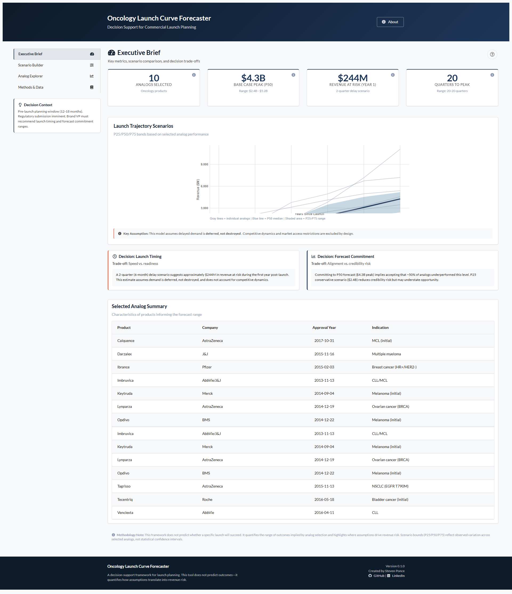
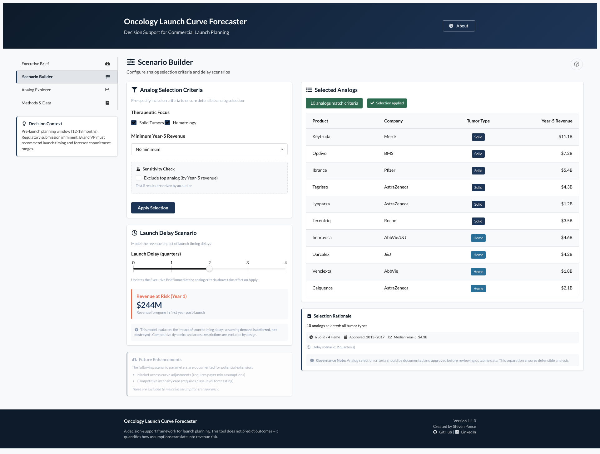
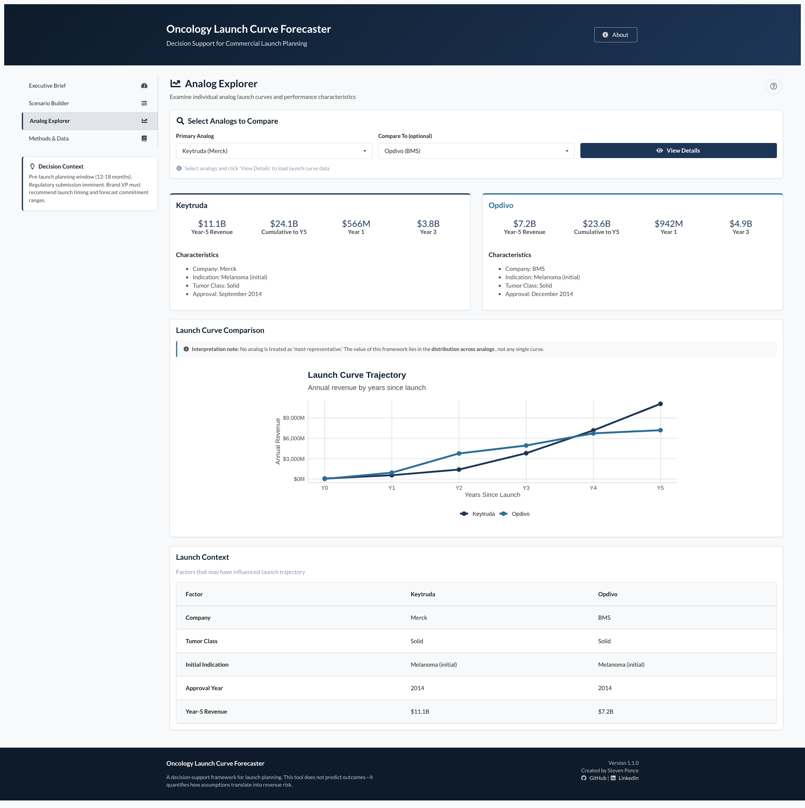
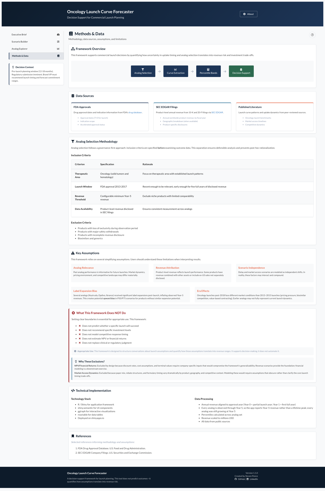

# Oncology Launch Curve Forecaster

    

**A governance-first decision support framework for pharmaceutical launch planning**

------------------------------------------------------------------------

## Overview

This project presents a decision support framework for pre-launch planning that quantifies how uncertainty in uptake timing and analog selection translates into **revenue risk and forecast trade-offs**.

The framework is designed for commercial launch planning contexts where leaders must reason under uncertainty, evaluate assumptions transparently, and communicate trade-offs clearly across functions.

**Intended Use Context**

-   **Decision Window:** Pre-launch planning (12–18 months from approval)
-   **Domain:** Oncology therapeutics (solid tumors and hematologic malignancies)
-   **Typical Users:** Commercial, brand, and planning leaders involved in launch readiness and forecasting discussions

------------------------------------------------------------------------

## Live Dashboard

🔗 **Interactive Shiny dashboard:**\
[Launch Curve Forecaster](https://0l6jpd-steven-ponce.shinyapps.io/launch_curve_forecaster/) (ShinyApps.io)

------------------------------------------------------------------------

## Core Decision Question

> **What is the revenue at risk if launch timing shifts under uncertainty?**

This framework supports that question by:

-   Structuring analog-based launch scenarios using a governance-first methodology
-   Quantifying **Year 1 revenue at risk** under configurable launch delay assumptions
-   Supporting P25 / P50 / P75 forecast trade-off discussions across stakeholders
-   Documenting assumptions, exclusions, and sensitivities transparently for audit and review

------------------------------------------------------------------------

## Key Capabilities

| Capability | Implementation |
|----|----|
| Governance-first analog selection | Inclusion criteria locked before examining outcomes |
| Revenue-at-risk quantification | Year 1 impact from configurable delay scenarios |
| Sensitivity testing | Option to exclude the top-performing analog (by peak revenue) |
| Dynamic selection rationale | Live statistics: solid/heme count, approval-year range, median peak |
| Transparent methodology | Assumptions, limitations, and exclusions clearly documented |

------------------------------------------------------------------------

## What This Framework Does

✅ Structures analog-based launch scenario analysis\
✅ Quantifies revenue ranges from analog variation (P25 / P50 / P75)\
✅ Supports structured trade-off conversations under uncertainty\
✅ Documents assumptions and limitations transparently\
✅ Provides sensitivity checks to test analytical robustness

------------------------------------------------------------------------

## What This Framework Does *Not* Do

❌ Predict whether a specific launch will succeed\
❌ Recommend specific investment or resourcing levels\
❌ Model competitive response or market access dynamics\
❌ Estimate NPV or financial returns\
❌ Replace clinical, regulatory, or strategic judgment

**By design:**\
NPV and market access modeling are excluded because they require company-specific inputs that would compromise generalizability. Revenue scenarios are treated as **foundational inputs**, not final financial outputs.

------------------------------------------------------------------------

## Dashboard Preview

### Executive Brief

 *High-level summary with key metrics (analog count, peak revenue range, Year 1 revenue at risk), scenario comparison chart, and decision framing.*

### Scenario Builder

 *Configure analog selection criteria, test delay scenarios, and examine dynamic selection rationale with live statistics and sensitivity checks.*

### Analog Explorer

 *Examine individual analog launch curves and performance characteristics, with guardrails against over-interpretation of any single analog.*

### Methods & Data

 *Transparent documentation of methodology, data sources, assumptions, limitations, and explicitly excluded modeling domains.*

------------------------------------------------------------------------

## Methodology

### Analog Selection (Governance-First Approach)

Inclusion criteria are specified **before** examining outcome data to ensure defensible analysis:

-   **Therapeutic area:** Oncology (solid tumors and/or hematology)
-   **Peak revenue threshold:** Configurable minimum (filters speculative analogs)
-   **Data availability:** Product-level revenue disclosed in SEC filings
-   **Sensitivity check:** Option to exclude the top-performing analog to test robustness

------------------------------------------------------------------------

### Scenario Construction

Percentile bands are derived from observed analog performance:

-   **P50 (Base Case):** Median analog trajectory
-   **P75 (Upper Range):** Upper quartile performance
-   **P25 (Lower Range):** Lower quartile performance

> **Important:** These represent observed analog ranges, not statistical confidence intervals.

------------------------------------------------------------------------

### Revenue-at-Risk Calculation

```         
Revenue at Risk (Year 1) = delay_quarters × (median Year 1 revenue / 4)
```

This is a **Year 1 average-quarter approximation**, explicitly labeled to match the calculation methodology.

------------------------------------------------------------------------

## Key Assumptions Documented

-   **Demand deferral:** Delayed demand is deferred, not destroyed
-   **Label expansion bias:** Some analogs experienced post-launch indication expansion, creating potential upward bias
-   **Era effects:** Launch dynamics differ between earlier (2013–2015) and more recent oncology approvals

------------------------------------------------------------------------

## Data Sources

| Source | Purpose | Access |
|----|----|----|
| SEC EDGAR filings | Product-level revenue (10-K reports) | [SEC EDGAR](https://www.sec.gov/edgar) |
| FDA Drug Approvals | Approval dates (T=0), indications | [FDA.gov](https://www.fda.gov/drugs) |
| Published literature | Launch curve patterns and benchmarks | Peer-reviewed sources |

All data used is publicly available. No proprietary or confidential information is included.

------------------------------------------------------------------------

## Analog Set (10 Oncology Products)

The framework includes established oncology launches with disclosed product-level revenue:

-   **Solid tumors:** Keytruda, Opdivo, Ibrance, Tagrisso, Lynparza, Tecentriq
-   **Hematology:** Imbruvica, Darzalex, Venclexta, Calquence

------------------------------------------------------------------------

## Technology Stack

| Component     | Technology                   |
|---------------|------------------------------|
| Language      | R (4.3+)                     |
| Framework     | Shiny (modular architecture) |
| UI components | shiny.semantic (Appsilon)    |
| Visualization | ggplot2, ggiraph             |
| Tables        | reactable, reactablefmtr     |
| Deployment    | shinyapps.io                 |

------------------------------------------------------------------------

## Design Principles

-   **Governance-first thinking** — lock criteria before examining outcomes
-   **Transparency over performance** — document assumptions and limitations
-   **Appropriate restraint** — clearly state what the tool does *not* do
-   **Decision support, not automation** — inform judgment, do not prescribe
-   **Executive communication** — lead with insights, support with data

------------------------------------------------------------------------

## Limitations

-   Revenue data from SEC filings may include ex-US sales
-   Label expansion can introduce upward bias in peak revenues
-   Earlier analogs may not fully reflect current launch environments
-   Revenue-at-risk calculation is simplified (not a full DCF model)
-   Competitive dynamics and market access are not modeled

------------------------------------------------------------------------

## Author

**Steven Ponce**\
Data Analyst \| R Shiny Developer \| Pharmaceutical Analytics

-   🔗 Portfolio: [stevenponce.netlify.app](https://stevenponce.netlify.app)
-   🐙 GitHub: [\@poncest](https://github.com/poncest)
-   💼 LinkedIn: [stevenponce](https://www.linkedin.com/in/stevenponce)

------------------------------------------------------------------------

## License

Released under the MIT License.

------------------------------------------------------------------------

## Disclaimer

This project is a **portfolio case study** intended to demonstrate analytical framing, governance, and decision-support design using publicly available data.

It is **not intended for real-world commercial decision-making** and is not affiliated with any pharmaceutical company. Product names are used for analytical illustration only.

------------------------------------------------------------------------

**Version:** 1.0.0\
**Last updated:** January 2026
